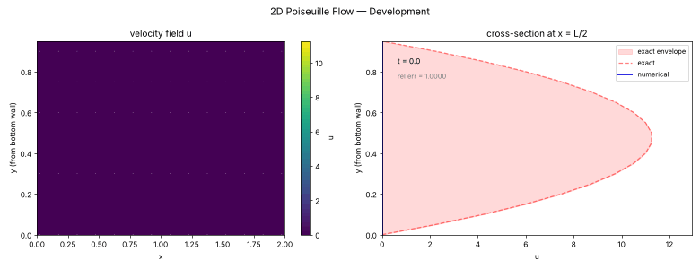
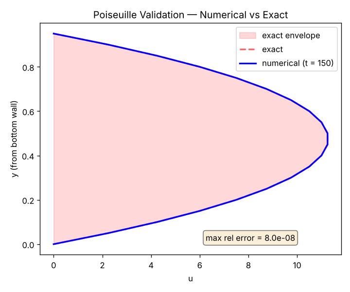

# 2D Navier-Stokes Solver

A 2D incompressible Navier-Stokes solver in Python (NumPy/SciPy), built on a MAC staggered grid with Chorin's projection method. It is validated against the analytical solution for pressure-driven channel flow (Poiseuille flow).



## Method

- **Grid:** MAC (marker-and-cell) staggered grid. `u` sits on vertical cell edges, `v` on horizontal edges and `p` at cell centres. This avoids the checkerboard pressure mode of collocated grids.
- **Time stepping:** explicit, with an adaptive step limited by both the advective CFL condition and the diffusion stability limit.
- **Each step:**
  1. Advect (first-order upwind; used in the cavity case).
  2. Diffuse (central differences).
  3. Apply body force.
  4. Solve the pressure Poisson equation (sparse 5-point Laplacian, factorised once).
  5. Project to make the velocity divergence-free.

## Validation: Poiseuille flow

The test is a channel driven by a constant pressure gradient `G`, periodic in `x`, with no-slip walls. The steady analytical solution is

    u(y) = G / (2ν) · y · (H − y)

In this solver the walls sit on the first and last rows of `u`, so the wall-to-wall height is `H = (ny − 1)·Δy`. The comparison uses that height.

| Grid | ν | G | Re | Max relative error vs analytical |
|---|---|---|---|---|
| 40 × 20 | 0.01 | 1.0 | ≈ 1070 | 8.0 × 10⁻⁸ |



The 3-point Laplacian reproduces a parabolic profile exactly. So this test shows that the solver reaches the correct steady state (forcing, wall conditions, periodicity and projection all consistent). It does not measure spatial convergence order. Advection is zero in fully developed Poiseuille flow and is switched off for this case.

## Lid-driven cavity (experimental)

A lid-driven cavity case runs, but it is **not validated**. The current setup uses a 2 × 1 domain with walls placed on grid rows, not the unit-square cavity of the standard benchmark (Ghia, Ghia & Shin, 1982). A benchmark comparison requires those changes first.

## Usage

Requires Python 3.10+.

```
python -m venv .venv
.venv\Scripts\activate          # Windows
source .venv/bin/activate        # macOS/Linux
pip install -r requirements.txt
python Solver.py poiseuille
python Solver.py cavity
python Solver.py --help
```

Options: `--nu`, `--G`, `--u-lid`, `--nx`, `--ny`, `--t-end`. Use `--save figures --gif` to write the figures and animation, and `--no-show` to skip the plot windows.

## Tests

```
pytest
```

The tests check that diffusion conserves its integral, that a uniform flow is unchanged by advection, that projection removes divergence, that Poiseuille flow matches the analytical solution, and that the cavity case runs without diverging.

## Authorship

The code was written with an AI assistant (Claude). My part was working through the numerical method and the analytical Poiseuille solution, and verifying the solver's results against it.
